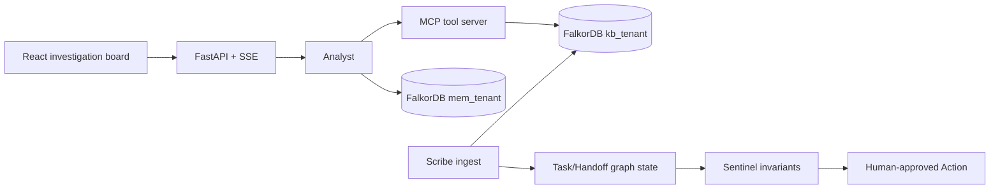

# WHYBASE

**Every answer, with its receipt.**

WHYBASE is a small company-brain demo for the WeMakeDevs × FalkorDB Graph Hacks challenge. It answers questions that need more than one record—who owns a service, what an incident came from, which decision replaced another—and shows the path it used to get there.

## Why this is a graph product

FalkorDB is the primary source of truth. Remove it and the connected investigation flow fails loudly; the UI does not silently switch to another database. Graph ON traverses typed relationships and temporal ownership edges. Graph OFF is an intentionally weaker vector-style baseline used by Arena to make the difference visible.



## Run locally

```powershell
Copy-Item .env.example .env
docker compose up --build
```

Open `http://localhost:8000` for the UI and `http://localhost:3000` for FalkorDB Browser. The dataset is synthetic and deterministic (`seed=42`); no private or scraped-restricted data is used.

The backend is deliberately honest about FalkorDB: if the graph is not reachable, `/health` reports `required-but-unavailable` and graph actions return a clear 503 instead of quietly switching to another database.

## Graph data model

Knowledge graphs are isolated as `kb_northwind` and `kb_halcyon`; agent memory graphs are `mem_northwind` and `mem_halcyon`.

`Person`, `Team`, `Project`, `Service`, `Document`, `Chunk`, `Decision`, `Incident`, and `Ticket` are connected by `MEMBER_OF`, `OWNS`, `WORKED_ON`, `AUTHORED`, `MENTIONS`, `DEPENDS_ON`, `DECIDED`, `DOCUMENTED_IN`, `SUPERSEDES`, `AFFECTS`, `CAUSED_BY`, `RESOLVED_BY`, `PART_OF`, and `COLLABORATES_WITH`.

## Cypher and algorithms

| Capability | Purpose | Source |
|---|---|---|
| Dependency traversal | Explain blast radius and multi-hop ownership | `backend/whybase/queries/core.py` |
| Temporal `OWNS` filter | Answer as-of ownership questions | `backend/whybase/queries/core.py` |
| Decision lineage | Preserve superseded decisions and their sources | `backend/whybase/queries/core.py` |
| Absence proof | Return scanned counts and zero connecting paths | `backend/whybase/queries/core.py` |
| PageRank / WCC / CDLP | Critical services and communities | FalkorDB algorithms docs; fallback query is documented |

## Tracks

WHYBASE enters all three tracks: **Track 01 — Act on Connected Data**, **Track 02 — Memory & Coordination**, and **Track 03 — Company Brain**.

## Deliverables

- `docs/EXPLAIN.md`: judge-facing architecture and query explanations
- `docs/DEMO_SCRIPT.md`: three-minute demo sequence
- `docs/AI_USAGE.md`: AI-generated and human-verified work
- `benchmark/questions.json`: deterministic benchmark questions and ground truth
- `results/arena_latest.json`: generated Arena output

## Notes for the demo

The seed is deterministic so the same questions produce the same evidence on every run. Graph OFF is intentionally a weaker retrieval mode for the Arena comparison; it is not a second source of truth. Actions raised by Sentinel are drafts until a person clicks Approve.

The project enters Track 01, Track 02, and Track 03. The data is synthetic, the AI assistance is disclosed in `docs/AI_USAGE.md`, and the exact demo order is in `docs/DEMO_SCRIPT.md`.
